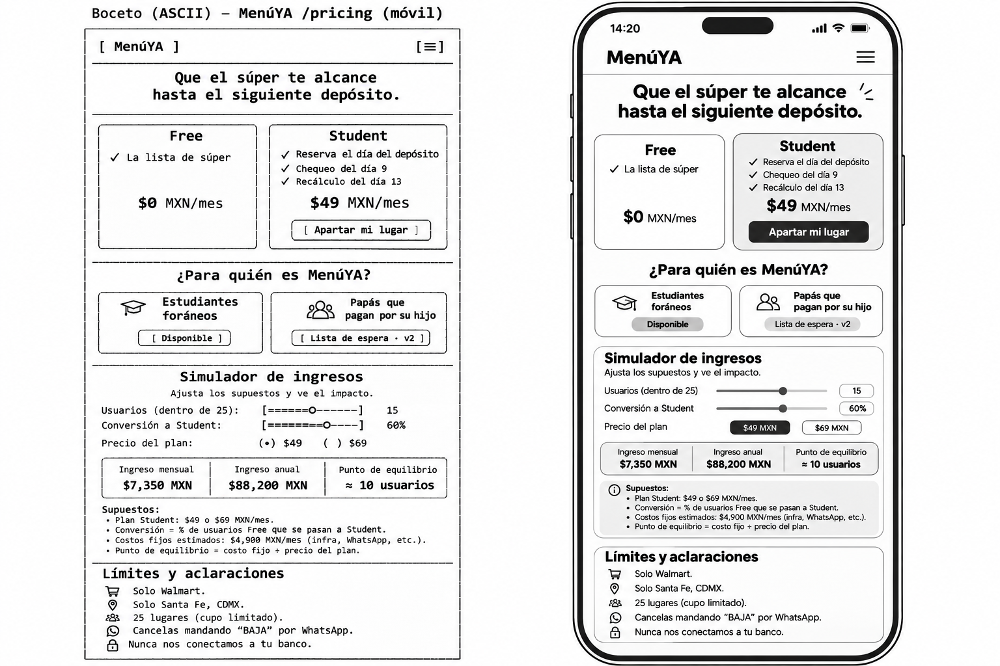
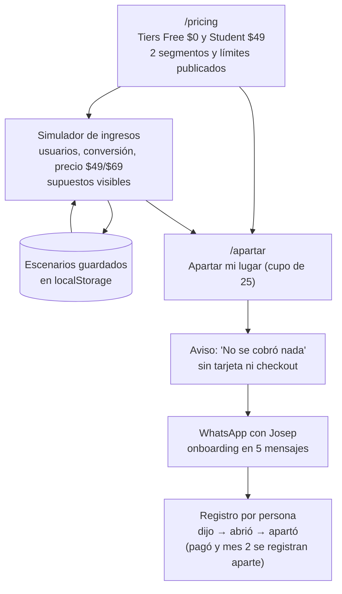
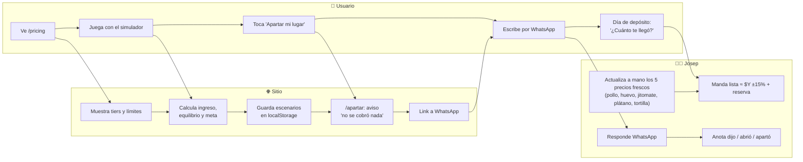

# PACKET — Semana 14 · MenúYA · Pricing

> **Nota de honestidad:** Escrito el 9 nov 2026, después del plan de Fase 1 y 2 y durante el build; el plan previo al código está en el BUILDCHAT.

**Venture:** MenúYA, planeación de súper para jóvenes que viven solos
**Autor:** Josep Ferré Gil (lente USER) · Equipo 7
**Fuentes:** Crystal Ball Semana 14, mi BRIEF de User, los briefs de Money, Operator, Adversary y Technologist, y el BLUEPRINT del equipo 7 (9 nov 2026)

---

## 1. El problema en mis palabras

El problema no es que se tire comida. Es lo que pasa entre los días 12 y 15. A U2 su depósito le llega y siente que alcanza, pero unos días antes del siguiente ya no le queda nada y termina pidiendo Uber Eats. Mis propios pedidos son por comodidad, no por falta de dinero, así que mis recibos no sirven para medir este dolor; solo sirven para calcular cuánto cuesta un pedido solo. U2, un amigo foráneo de Sonora, lo dijo sin que le preguntara: *"Normalmente pido más entre el 12 y el 15."* También dejó clara su condición para pagar: *"Si nada más me dice qué comprar pero termino gastando lo mismo no tendría caso la neta."*

O sea, nadie quiere pagar por una lista, porque cualquier chatbot te la da gratis. Lo que sí vale es saber que el dinero va a alcanzar. Hoy nadie en México convierte el depósito en una lista con precios mexicanos reales, en español y pensada para que la comida dure hasta el siguiente depósito.

Estado honesto: entrevisté a 2 amigos y a 0 desconocidos, y nadie ha pagado. Un "sí" dicho de palabra cuenta como cero.

## 2. Usuario exacto

**Un estudiante foráneo que vive solo en Santa Fe (CDMX) y recibe un depósito fijo de sus papás.** Gasta entre $2,500 y $3,000 al mes en súper. Más o menos entre el día 12 y el 15 se le acaba el dinero y esos días pide más comida a domicilio.

- **Lo que hace hoy:** compra sin plan, a veces le pide la lista a ChatGPT y en los días 12–15 pide Uber Eats.
- **Lo que le cuesta:** una sola orden solo de ~$610 contra ~$60 de una comida planeada en casa, así que cada orden que evita le ahorra ~$550.
- **Quién NO es (todavía):** los papás que pagan por su hijo (v2), los jóvenes que cobran por quincena (es una hipótesis y llevo 0 entrevistas) y quien compra en mercados o tienditas.

## 3. Definición de éxito

> **"Antes de que cierre el módulo, `/pricing` con el simulador de ingresos y el flujo `/apartar` funcionan en menuyamx.xyz con números correctos, y cada desconocido que contacto queda registrado como dijo → abrió → apartó. Si al domingo 15 de noviembre son cero, ese cero también queda registrado como resultado."**

## 4. Mockup

*Archivo: `docs/mockup-pricing.png`. Lo generé con IA (a la izquierda está el boceto ASCII y a la derecha la versión en celular).*

**Ojo: los números del mockup estaban mal.** La IA dibujó bien la estructura (los tiers Free y Student, los dos segmentos, el simulador, los supuestos y los límites), pero inventó las cuentas. Esto fue lo que corregí en el build:

| Dato | Mockup (mal) | Corregido |
|---|---|---|
| Ingreso | $7,350/mes y $88,200/año, que no salen de 15 usuarios con 60% de conversión | Ingreso = usuarios que pagan × **$43.47 neto**, ya sin la comisión estimada tipo Stripe (procesador aún no decidido). Ejemplo: 12 pagando dan $522/mes y $6,260/año |
| Costo fijo | $4,900/mes | **v1: $480/mes** (~4 h de mi tiempo × $120/h) · **v2: $1,179/mes** ($480 + ~$699 del proveedor de WhatsApp) |
| Punto de equilibrio | ≈ 10 usuarios, y además $4,900 ÷ $49 da 100, no 10 | **v1: 12 usuarios · v2: 28 usuarios** (costo fijo ÷ neto, redondeado hacia arriba) |
| Conversión | 60% | **3%** de Free a Student como default (se puede editar y los supuestos se ven) |
| Fórmula | costo fijo ÷ precio del plan | costo fijo ÷ **neto** por usuario, porque Stripe se queda con una parte |

## 5. Flujo principal

## 6. Swimlane: quién hace qué

## 7. Benchmark

> **La mejor solución existente es Mealime (plan → lista, Pro $2.99 USD/mes); la mía localiza a México: precios reales de Walmart y planeación según la fecha del depósito.**

- **Lo que adapto de otros:** de Mealime, el paywall suave (el Free sirve de verdad). De Kitche, el inventario con poco esfuerzo, que aquí es un chequeo de 10 segundos el día 9. De Cheaf, enfocarme en una sola zona, y lo mando como link el día 13 en vez de competir con él. De Food on the Table, empezar como concierge y automatizar un paso a la vez.
- **Por qué no basta con ChatGPT:** en mi prueba del 9 nov contra walmart.com.mx, sus precios tuvieron un error promedio de 24.9%, 9 de 10 productos salieron sobreestimados y hasta sumó mal su propia lista.
- **El gap real es más chico de lo que dije al principio:** español, precios mexicanos y planear alrededor de la fecha del depósito. Saber qué hay en el refri no es nuevo.

## 8. Visión a 3 años

En 3 años, MenúYA es la forma normal en que un joven que vive solo en México convierte su depósito en comida que le dura hasta el siguiente, con precios reales de varias cadenas y no solo de Walmart. Los precios frescos se actualizan sin que yo esté detrás de cada uno, y el segmento de papás que pagan por su hijo ya funciona sin vigilar al estudiante. Y lo más importante es que siga cumpliendo lo mismo de hoy: MenúYA nunca gana más cuando el usuario gasta más.

## 9. Lo que NO construyo (esta semana)

- **Cobro real:** no hay checkout ni datos de tarjeta en el sitio. `/apartar` solo aparta un lugar y lo dice claramente.
- **App nativa:** por ahora son sitio web + WhatsApp. Además, las tiendas de apps cobran ~15%.
- **Mercados y tienditas:** solo Walmart. La comida del mercado no tiene ticket ni precio fijo.
- **Segmento papás (v2):** aparece en /pricing como "Lista de espera · v2" y nada más. El Blueprint lo mató para v1 (5/5).
- **Conexión al banco:** nunca. El usuario escribe un solo número: "¿Cuánto te llegó?"

## 10. Arquitectura y stack

| Pieza | Herramienta | Para qué / notas |
|---|---|---|
| Framework | **Next.js 16** | Páginas `/pricing` y `/apartar` y el simulador del lado del cliente |
| Hosting | **Vercel** | Preview en la rama `semana-14`; producción en **menuyamx.xyz** después del merge |
| Base de datos | **Supabase** | Se queda como en la Semana 13. **Esta semana no agrego tablas nuevas** |
| Escenarios del simulador | **localStorage** | Se guardan en el navegador del usuario, sin cuenta y sin servidor |
| Código | **GitHub** | Rama `semana-14` → PR → merge a `main` |
| Operación (fuera del código) | WhatsApp Business (gratis) + Google Sheet restringida | Onboarding a mano, precios de la semana y registro dijo/abrió/apartó |

## 11. Plan de pruebas

**Cuentas del simulador a $49**
- [ ] Neto por usuario = $49 − (3.6% × $49 + $3) × 1.16 = **$43.47**
- [ ] Equilibrio v1 = ⌈$480 ÷ $43.47⌉ = **12 usuarios**
- [ ] Equilibrio v2 = ⌈$1,179 ÷ $43.47⌉ = **28 usuarios**
- [ ] Meta del burn rate = ⌈$9,343 ÷ $43.47⌉ = **215 usuarios que pagan**
- [ ] A $69: neto $62.64, equilibrio v1 8 y v2 19 (para la prueba dividida $49/$69)
- [ ] Ingreso anual = ingreso mensual × 12, y la conversión default es 3%

**Validación de inputs**
- [ ] No acepta negativos, texto, ni campos vacíos sin mostrar un aviso
- [ ] La conversión va de 0% a 100%
- [ ] Con «Otro precio» menor a $15 (por ejemplo $10) se muestra la advertencia de que la comisión fija se come ~un tercio; con $15 o más ya no aparece
- [ ] Los usuarios que pagan en v1 marcan el tope de 25

**Escenarios guardados**
- [ ] Guardar, recargar la página y que el escenario siga ahí
- [ ] Borrar un escenario
- [ ] Si localStorage no funciona (por ejemplo en modo incógnito), el simulador sigue jalando sin romperse

**Acceso y regresión**
- [ ] `/pricing` y `/apartar` abren sin login
- [ ] Las páginas de la Semana 13 se ven y funcionan igual que antes
- [ ] No hay checkout, ni campos de tarjeta, ni llamadas a Stripe desde el sitio
- [ ] `/apartar` muestra el aviso "No se cobró nada"

**Celular**
- [ ] Prueba en un celular real (iPhone y Android si consigo los dos): los tiers, los sliders, los botones $49/$69 y el link de WhatsApp funcionan con el dedo

## 12. Condiciones del Blueprint y cómo las respeto

| # | Condición | Cómo la respeto |
|---|---|---|
| 1 | **Shadow clause:** el ingreso nunca crece cuando el usuario gasta más | El simulador solo modela suscripciones. No hay productos patrocinados ni % del ticket, y no se venden datos de compra. Una comisión de referido, si algún día existe, sería fija por orden |
| 2 | **Nunca un precio único** | Las listas siempre se muestran como rango ("≈ $Y ±15%") con reserva. El rango se abre si el chequeo de frescos muestra más variación |
| 3 | **Salir es tan fácil como entrar** | /pricing dice "Cancelas mandando BAJA por WhatsApp", sin preguntas ni ofertas para retenerte. El congelado de ahorro es opcional y viene con advertencia |
| 4 | **Tope de 25 usuarios en v1 y límites publicados** | En /pricing se ve: solo Walmart, solo Santa Fe, 25 lugares y lista de espera. Nada de mercados |
| 5 | **Ningún "sí" cuenta hasta que un desconocido paga con su propio dinero** | Apartar NO es pagar. El registro separa dijo → abrió → apartó → pagó → mes 2. U1 y U2 no cuentan |
| 6 | **Datos del depósito protegidos y ley revisada antes de cobrar** | El sitio no pide el monto del depósito, eso pasa solo por WhatsApp. Los montos se borran de los chats cada mes y quedan en una sola hoja restringida. Reviso SAT (RESICO) y la ley de datos personales antes de cobrarle a cualquier desconocido |

---

*Disenso preservado (el disenso es dato): Money y Technologist piensan que $49 podría ser poco para un servicio hecho por una persona, y yo me quedo en $49 hasta que la evidencia diga otra cosa. Adversary dice que MenúYA todavía no ha demostrado ser distinto de Nu, Cheaf o los chatbots gratis, y que llevamos cero pagos de desconocidos.*
