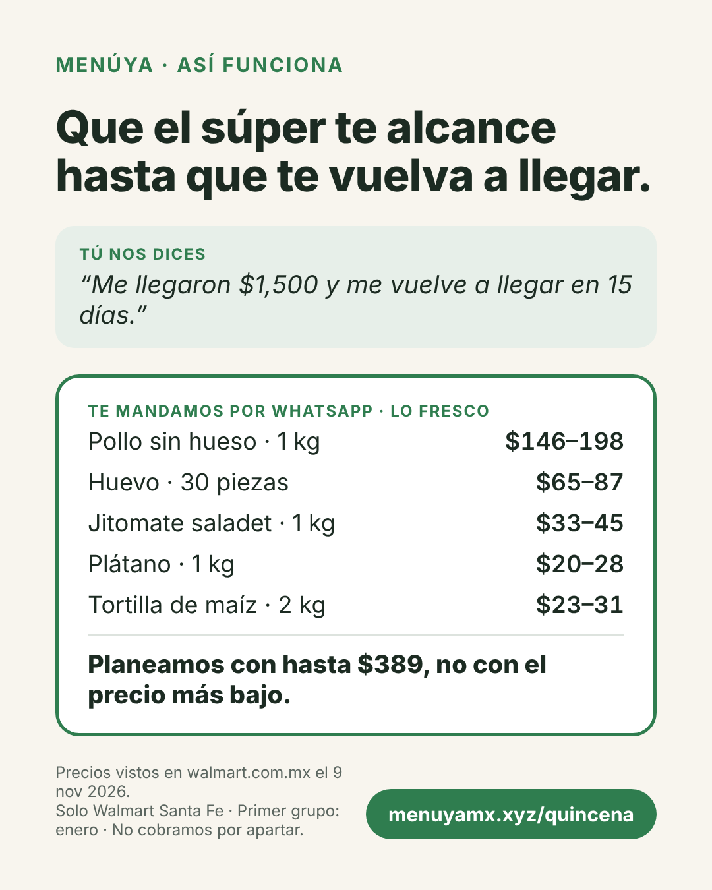
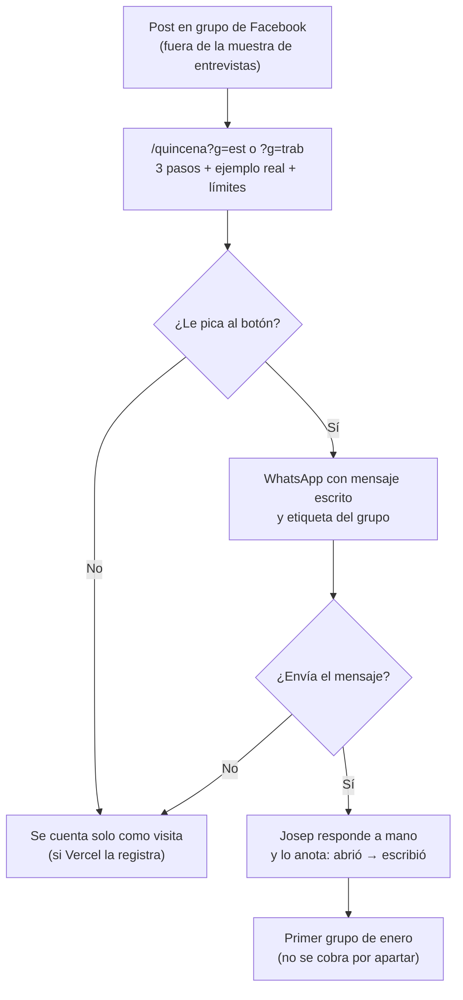
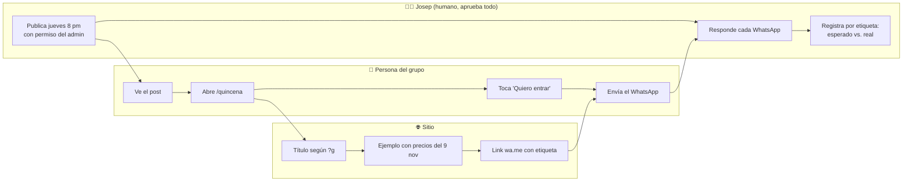

# PACKET — Semana 15 · MenúYA · Distribution

> **Nota de honestidad:** escrito el 17 nov 2026, después de construir `/quincena` (rama `semana-15`, merge `5f0a52a`) y antes de publicar las piezas (jueves 19 nov, 8 pm). Lo que no cambia esta semana se queda en `PACKET-semana-14.md` y no se reescribe aquí. El plan y las decisiones están en el BUILDCHAT y en `DECISIONS.md`.

**Venture:** MenúYA, planeación de súper con presupuesto primero, para que la comida dure hasta el siguiente depósito
**Autor:** Josep Ferré Gil (lente OPERATOR) · Equipo 7
**Fuentes:** Crystal Ball Semana 15, mi BRIEF de Operator (17 nov), PACKET y DECISIONS de la Semana 14, `docs/precios-frescos-2026-11-09.md`

---

## 1. El problema en mis palabras (actualizado)

El momento de la necesidad no es una fecha fija: es el tramo antes del siguiente depósito, más o menos entre el 60% y el 85% de cada ciclo de pago (días 9–13 de una quincena, días 18–25 de un depósito mensual). Lo que se paga no es una lista, es saber que el dinero va a alcanzar.

**Lo que cambió esta semana:** mi punto de partida como Operator es cero. Mi plan de la Semana 14 era publicar el 10 nov y tener un desconocido que pagara el 15. No publiqué. Al 17 nov: 0 desconocidos, 0 links de pago, 0 pagos. Ese es el punto de partida, no una nota al pie.

## 2. Usuario exacto (sin decidir, a propósito)

Esta semana no elijo audiencia por intuición. Hay dos candidatos y una regla escrita antes de tener datos (ver BRIEF):

| | Estudiante foráneo | Trabajador por quincena |
|---|---|---|
| Quién | Vive en Santa Fe, depósito fijo de sus papás | 20–30 años, vive con roomies (Santa Fe, Del Valle/Narvarte) |
| Usuario = pagador | Sí en v1, aunque puede ser "medio hogar" (U2 pagaría "si mi roomie pone su mitad") | Sí |
| Lo que hace hoy | Compra sin plan; delivery al final del ciclo | Igual (hipótesis, 0 entrevistas) |
| Evidencia | 1 amigo (U2). U1 no tiene problema de dinero y ya no cuenta | Ninguna todavía |

**A quién NO apunto:** papás que pagan (v2), quien compra en mercados o tienditas, quien no vive en CDMX, y cualquiera fuera de Walmart Santa Fe.

## 3. Definición de éxito (Semana 15)

> **"`menuyamx.xyz/quincena` funciona en producción, las 2 piezas se publican el jueves 19 nov a las 8 pm en grupos fuera de mi muestra de entrevistas, y cada respuesta queda registrada por etiqueta ("soy estudiante" / "trabajo y cobro por quincena"). Si al domingo 22 nov hay cero mensajes, ese cero se reporta como resultado."**

## 4. Mockup

*Archivo: `docs/pieza1-estudiantes.png` (1080×1350). La generé con IA a partir de la misma plantilla visual que `/quincena`. Los precios no son inventados: vienen de `precios-frescos-2026-11-09.md`.*

## 5. Flujo principal

## 6. Swimlane: quién hace qué

## 7. Launch playbook

### 7.1 Estrategia

| | |
|---|---|
| **Audiencia** | Foráneos y jóvenes con roomies en CDMX a los que se les acaba el dinero antes del siguiente depósito. Esta semana pruebo los dos segmentos por separado. |
| **Necesidad** | Que el súper alcance hasta que vuelva a llegar dinero, sin pedir delivery los últimos días. |
| **Posicionamiento** | No es una app de recetas ni de ahorro: es una lista de Walmart con precios revisados a mano, planeada con el precio más alto, ajustada a media quincena. Por WhatsApp, sin tocar tu cuenta. |
| **Evidencia** | U2: *"Normalmente pido más entre el 12 y el 15."* Prueba ChatGPT vs. walmart.com.mx (9 nov): 24.9% de error promedio → por eso los precios se revisan a mano. Precios frescos del 9 nov. |
| **Promesa que NO hago** | No prometo cuánto vas a ahorrar ni precios exactos. El ±15% sigue sin medir (la prueba con ticket real es antes del 5 dic). |

### 7.2 Marca

**Tres reglas de voz**
1. **Habla como un amigo foráneo, no como un banco.** Tú, frases cortas, palabras de CDMX ("te llegó", "se te acaba"). Nada de "optimiza tus finanzas".
2. **Cada número trae su fuente y su fecha.** Si no lo medí, no lo digo.
3. **Di los límites antes de que pregunten.** Solo Walmart, solo Santa Fe, grupo chico, no cobramos por apartar.

**Una línea débil, reescrita**
- Antes (home de la Semana 13): *"¿Cuánto se te va en comida que tiras?"* — habla del desperdicio, que no es el dolor real, y suena a regaño.
- Después (`/quincena`): *"¿La quincena se te acaba antes de la quincena?"* — nombra el momento real y se entiende en un segundo.

**Paleta**

| Rol | Color | Uso |
|---|---|---|
| Marca | `#2f7d4f` | Botones, etiquetas, bordes de tarjetas |
| Marca oscura | `#23603c` | Hover y texto sobre fondo verde claro |
| Fondo | `#fbf8f1` | Fondo crema, como papel de lista del súper |
| Texto | `#1f2a1f` | Títulos y cuerpo |
| Apoyo | `#e7efe9` | Burbuja de "lo que tú nos dices" |

**Jerarquía tipográfica:** etiqueta en mayúsculas espaciadas (verde, peso 700) → título grande (peso 800) → cuerpo (peso 400) → cifras alineadas con números tabulares → letra chica gris para fuente y fecha. En la web es Geist; en las imágenes, Inter (misma familia de sans geométrica).

**Layout repetible (todas las piezas):** etiqueta de serie → título → burbuja "tú nos dices" → tarjeta verde con la salida → línea de total → pie con fuente, fecha y límites → botón con `menuyamx.xyz/quincena`.

**Por qué encaja con la audiencia y con México:** el verde y el crema se ven como lista del súper, no como fintech. WhatsApp es el canal porque es donde ya vive la audiencia y no pide descargar nada. Las cifras están en pesos y con precios de Walmart, no en dólares de una app gringa. Decir "quincena" y "depósito" nombra cómo le llega el dinero a la gente aquí.

### 7.3 Rango creativo: 3 series × 2 conceptos

| Serie | Concepto | Formato | Estado |
|---|---|---|---|
| **A · Así funciona** (entrada → salida) | A1. "Me llegaron $1,500, faltan 15 días" → lo fresco de la lista | Imagen + texto | ✅ **Terminada** (pieza 1, estudiantes) |
| | A2. "Me llegaron $3,000 al mes" → lista para un depósito mensual | Imagen | Boceto: mismo layout, ciclo de 30 días |
| **B · Días 9–13** (el momento) | B1. "¿En qué día se empieza a apretar?" | Solo texto | ✅ **Terminada** (pieza 2, trabajadores) |
| | B2. Mensaje real del día 9: "¿Qué te queda en el refri?" (captura simulada, etiquetada) | Captura | Titular: *"10 segundos el día 9 para no pedir delivery el 13."* |
| **C · La cuenta real** (precios revisados) | C1. Página `/quincena`: ejemplo, límites y lo que no prometemos | Página web | ✅ **Terminada** |
| | C2. "ChatGPT vs. Walmart: 24.9% de error" | Carrusel | Titular: *"Le pedí precios a un chatbot y los revisé uno por uno."* |

3 terminadas, 3 formatos (imagen, texto, página web). Las 2 que se prueban con la audiencia son A1 y B1.

### 7.4 Ejemplo real: entrada → método → salida

- **Entrada:** "Me llegaron $1,500 y me vuelve a llegar en 15 días."
- **Método:** tomo los precios vistos en walmart.com.mx el 9 nov, los muestro como rango y planeo con el máximo de cada rango (quedarse corto es lo que rompe la promesa).
- **Salida:** pollo 1 kg $146–198 · huevo 30 pz $65–87 · jitomate 1 kg $33–45 · plátano 1 kg $20–28 · tortilla 2 kg $23–31 → **planeamos con hasta $389** solo en frescos.

### 7.5 Prueba de distribución

| | Pieza 1 (A1) | Pieza 2 (B1) |
|---|---|---|
| Audiencia | Estudiantes foráneos | Trabajadores por quincena |
| Canal | 1 grupo de Facebook de foráneos, fuera de la muestra, con permiso del admin | 1 grupo de roomies, fuera de la muestra, con permiso del admin |
| Link | `menuyamx.xyz/quincena?g=est` | `menuyamx.xyz/quincena?g=trab` |
| Siguiente paso | WhatsApp con "(soy estudiante)" | WhatsApp con "(trabajo y cobro por quincena)" |
| Cuándo | Jueves 19 nov, 8 pm | Jueves 19 nov, 8 pm |

**Por qué canales separados:** el post neutral de entrevistas va solo a los 4 grupos del brief. Si las piezas de MenúYA fueran a los mismos grupos, la gente llegaría a la entrevista sabiendo qué busco y el criterio 1 ("lo mencionan sin que se los pregunte") dejaría de valer.

### 7.6 Resultados honestos

*Se llena el domingo 22 nov. No se publican nombres ni números de teléfono.*

| | Lo que espero | Lo que pasó |
|---|---|---|
| Reacciones / comentarios | 0–5 por post | |
| Mensajes "(soy estudiante)" | 0–2 | |
| Mensajes "(trabajo y cobro por quincena)" | 0–2 | |
| Visitas a `/quincena` (si Vercel las muestra) | — | |
| Lo que mantengo | | |
| Lo que cambio | | |

Cero respuestas es un resultado y se reporta así.

## 8. El proceso creativo, por roles

Cada rol es un chat separado de IA con una entrada, una salida y un control de calidad. **Ninguna pieza se publica sin que yo la apruebe.**

| Rol | Entrada | Salida | Control de calidad |
|---|---|---|---|
| **1. Investigación** | Brief, entrevistas, precios del 9 nov | 3–5 hechos con fuente y fecha | ¿Cada hecho tiene fuente y fecha? ¿Está marcado si es de amigos o autorreportado? |
| **2. Redacción** | Hechos + reglas de voz + serie | Texto del post (≤ 90 palabras) + titular | ¿Cumple las 3 reglas de voz? ¿Hay una sola acción? |
| **3. Producción visual** | Texto aprobado + paleta + layout | Imagen 1080×1350 | ¿Sigue el layout repetible? ¿Se lee en celular? |
| **4. Verificación de claims** | Texto + imagen + hojas de precios | Lista de cada número y de dónde sale | Ningún número sin fuente; ninguna promesa de ahorro; el total suma bien |
| **5. Revisión de estilo** | Pieza completa | Cambios sugeridos | Paleta, tipografía y tono iguales a las otras piezas |
| **6. Revisión final (humano)** | Todo lo anterior | Aprobado / no aprobado | Josep la lee en su celular, revisa reglas del grupo y decide |

**Este sprint en la práctica:** investigación y verificación las hice con los precios del 9 nov; la redacción y la imagen se hicieron en el chat de build; la verificación revisó que el total de $389 salga de sumar los máximos (también hay una prueba automática). Yo aprobé el texto y probé el link en el preview antes del merge.

## 9. Lo que NO construyo (esta semana)

- **Formulario o base de datos de interesados:** el único paso siguiente es WhatsApp. Así no guardo datos personales en el sitio.
- **Cuenta pública en redes:** no hace falta; las piezas van a grupos con permiso.
- **Cobro:** sigue sin RFC; no hay links de pago en las piezas.
- **10 posts:** no hay cuota. 6 conceptos, 3 terminados, 2 probados.
- **Automatización de los roles:** son chats separados, sin framework de agentes.

## 10. Arquitectura y stack

| Pieza | Herramienta | Notas |
|---|---|---|
| Página | **Next.js 16** | `/quincena` lee `?g=` en el servidor; sin formulario |
| Hosting | **Vercel** | Preview en la rama `semana-15`; producción en **menuyamx.xyz** (merge `5f0a52a`) |
| Base de datos | **Supabase** | Sin cambios esta semana; ninguna tabla nueva |
| Siguiente paso | **wa.me** | Mensaje escrito + etiqueta del grupo |
| Código | **GitHub** | Rama `semana-15` → merge a `main` |

## 11. Plan de pruebas

**Automáticas (`tests/quincena.test.ts`, 74/74 en total)**
- [x] Solo `?g=est` y `?g=trab` cambian el grupo; cualquier otra cosa (incluido `est<script>`) es "web"
- [x] El WhatsApp lleva la etiqueta correcta y va al número de MenúYA
- [x] El ejemplo planea con el máximo de cada rango ($389)
- [x] `/quincena` no tiene formulario ni promete ahorro
- [x] `/quincena` es pública en `src/proxy.ts`

**A mano (17 nov, por el dueño)**
- [x] Preview `?g=est` y `?g=trab`: el título cambia
- [x] El botón abre WhatsApp con la etiqueta del grupo (17 nov como [Q-EST]/[Q-TRAB]; desde el 18 nov, etiqueta legible tras el persona test)
- [x] Producción `menuyamx.xyz/quincena?g=trab` abre en celular sin login
- [x] `/pricing` sigue igual que la entrega de la Semana 14
- [x] Persona test sintético en chat nuevo: 3 rondas (ver `PERSONA_semana15.md`)

## 12. Condiciones del Blueprint y cómo las respeto

| # | Condición | Cómo la respeto |
|---|---|---|
| 1 | El ingreso nunca crece cuando el usuario gasta más | Las piezas no venden productos ni marcas; Walmart es solo la fuente de precios |
| 2 | Nunca un precio único | El ejemplo muestra rangos y planea con el máximo |
| 3 | Salir es tan fácil como entrar | La página dice que no se cobra por apartar ni se pide tarjeta |
| 4 | Límites publicados | Solo Walmart · solo Santa Fe · grupo chico, en la página y en la imagen |
| 5 | Ningún "sí" cuenta hasta que un desconocido paga | Un mensaje con etiqueta cuenta como "escribió", no como cliente |
| 6 | Datos protegidos | No hay formulario; los mensajes llegan a WhatsApp y no se publican nombres ni números |
