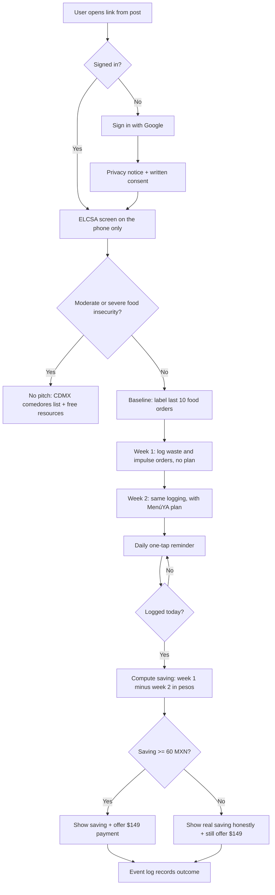
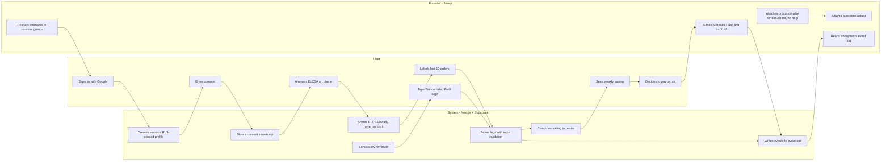

# MenúYA · Week 13 PACKET — "Contador de Ahorro"

**Author:** Josep Ferré · **Role:** 🗡 Adversary · **Venture:** MenúYA · **Week 13 — Real Humans**
**Status:** Packet before code. No code is written until this file is committed.

> Adversary framing: this week's slice is not the feature that makes MenúYA look good. It is the feature that can **kill** it. The 10:1 depends on one unproven number — a saving of **≥ $60 MXN a week** (waste + impulse spending). The Contador de Ahorro measures that number with real strangers, in pesos, without telling them what I expect.

---

## 1. Problem (in my words)

A foráneo living alone in CDMX buys groceries, throws part of them away, and then still pays for an OXXO run or a panic delivery around days 10–15 of the quincena. Nobody — not the user, not us — knows how many pesos that actually is. MenúYA's whole business case ($149 a semester ≈ 10:1) assumes it is at least $60 a week. If it isn't, there is no business, however nice the meal plan looks.

## 2. Exact user

An **employed foráneo, 24–30, living alone in CDMX**, who shops at a major supermarket chain (Soriana, Bodega Aurrerá, Chedraui, Walmart), spends roughly **$2,500–3,500 MXN a month on groceries**, and still orders delivery or makes unplanned purchases before payday.

Not this week's user: students spending $1,200–2,000 a month on food. They fall below INEGI's urban food basket ($2,590.61/month, Sept 2026) and the app refers them to CDMX comedores instead of selling to them.

## 3. Success definition

**Before the module closes, a stranger can go from a Facebook/WhatsApp post to Google sign-in, consent, 7 days of logging, and a screen showing "this week you saved $X vs. $60" — with no help from me — and at least one stranger pays $149.**

Measurable pass/fail bars (written before testing):

| Test | Pass | Fail |
|---|---|---|
| Weekly saving (waste + avoided impulse) | ≥ $60 MXN/week, week 2 vs week 1 | < $60 → 10:1 does not hold |
| Logging adherence | 7 of 7 days logged | Drop-off by day 3 |
| Unassisted onboarding | 0 price/consent questions, ≤ 2 usage questions | Any price/consent question |
| Willingness to pay | ≥ 1 stranger pays $149 | Nobody pays → 10:1 stays a hypothesis |
| Strangers | ≥ 3 of 5 users are strangers | Friends-and-family testing |

## 4. 🎨 Mockup (image-generated)

Prompt to paste into the LLM's image generator (save the result as `docs/mockup.png` and embed it here):

> Mobile app screen mockup, clean flat UI, Spanish text, warm green and off-white palette. App name "MenúYA" at top. Header: "Tu semana · 3 de 7 días registrados". Big card in the center: "Ahorro esta semana: $48 de $60" with a horizontal progress bar 80% full. Below it, two large one-tap buttons: "🗑 Tiré comida" and "🛵 Pedí algo / compra no planeada". Under those, a small list "Hoy: 1 bolsa de espinaca ($28), 3 tortillas ($6)". Small grey label at the bottom: "Datos de demostración · precios de referencia Profeco QQP, capturados dic 2025". Bottom nav bar with icons: Plan, Lista, Ahorro, Perfil. iPhone frame, realistic, minimal.

``

## 5. 📊 Flow

### 5a. Flowchart — how the Contador de Ahorro works

### 5b. Swimlane — who does what

## 6. 🌍 Benchmark line

- **The best existing solution on Earth for this is** Super / CestaChef (Spain): you enter your supermarket and weekly budget and get a weekly menu with a shopping list priced from Mercadona's catalog (Super: €44.99/year after a 3-day trial).
- **Mine differs or localizes by** pricing with Profeco's QQP data for Mexican chains, and by *measuring the user's real saving in pesos* (waste + avoided fin-de-quincena orders) instead of assuming it — at $149 a semester, not euros.

## 7. 🔭 Long view (3 years)

If this slice proves a real ≥ $60 a week saving, MenúYA becomes the money layer for food in Mexican single-person households: a plan, a list priced against the chain the user actually shops at, and a quincena-aware "rescue my remaining week" mode that cooks from what's in the fridge plus the money left. The proprietary asset is the Mexican data layer — recipe → product → price → seal status — which is hard to build and therefore hard to copy, unlike Spain's clean catalog. Distribution runs through student associations and employers' wellness programs, never through paid placement for sealed ultra-processed products.

## 8. Scope cut — what I am NOT building

- ❌ Fridge photos or any "AI scans your fridge" (no photos in v1, no cloud AI).
- ❌ Mercado prices (no dataset exists).
- ❌ "Rescue my remaining week" / tonight / batch modes (S3 and S5 asked for it — logged for Week 14+).
- ❌ In-app card payments or auto-renewal. Payment for the test = a Mercado Pago link sent by me. v1 is a **web app**, so no App Store commission applies yet.
- ❌ Paid placement or sponsored products of any kind.
- ❌ Storing ELCSA answers anywhere off the phone.
- ❌ Native iOS/Android apps.

## 9. Shadow clause — harms and the design decisions that answer them

| Harm | Design decision in this build |
|---|---|
| A cost optimizer drifts to the cheapest ultra-processed calories (28.2% of calories in Mexico already) | Plan only uses a whitelist of basics (frijol, tortilla, huevo, arroz, seasonal produce); no NOM-051 sealed products; if the budget can't cover every Plato del Bien Comer group, the app says so |
| Selling to people who can't afford to eat | Below $600/week budget or moderate/severe ELCSA → no plan, no paywall, CDMX comedores list |
| Collecting sensitive data on vulnerable users (2025 LFPDPPP) | Privacy notice + written consent before any data; ELCSA runs in the browser and is never sent; logs hold amounts and items, never names in demos |
| Extractive research | Test users keep the plan free whether they pay or not; session notes keep quotes, never names |
| A "saving" screen that lies | Show the real saving even when it's below $60; prices show "referencia QQP" + capture date |

## 10. Architecture + stack

| Layer | Choice | Why | Cost |
|---|---|---|---|
| Frontend | Next.js (App Router) + Tailwind | Fast, mobile-first web, deploys to Vercel | $0 |
| Hosting | Vercel + **real domain** (URL of record) | Required by the venture rule; preview deploys per commit | domain only |
| Auth | Supabase Auth — Sign in with Google | Stores personal data → auth required | $0 |
| Database | Supabase Postgres with **RLS ON** on every user table | User sees only their own rows | $0 |
| Validation | Zod on every form + DB `check` constraints | Length/type limits; nothing raw into the DB | $0 |
| Analytics / feedback (stack floor) | `events` table: `user_id, name, props(jsonb), created_at` — e.g. `signed_in`, `consent_given`, `log_added`, `reminder_opened`, `saving_viewed`, `pay_link_clicked` | Simple event log, no third-party tracker | $0 |
| On-device only | ELCSA scoring in browser memory; never stored or sent | Sensitive data stays on the phone | $0 |
| Prices | Static JSON of whitelisted items from QQP Dec 2025 file, with capture date | Reference prices only, labeled | $0 |
| Reminders | Browser notification + fallback: "Registrar hoy" banner on open | No SMS/WhatsApp API cost | $0 |
| Payment (test only) | Mercado Pago link, manual | No card data touches MenúYA | fees only |
| Secrets | Vercel environment variables only; `.env*` in `.gitignore` | Security floor | $0 |

**Tables (all RLS: `auth.uid() = user_id`):**
`profiles` (city, monthly grocery band, consent_at) · `baseline_orders` (label: antojo / no planeé / no tuve tiempo / otro, amount) · `waste_logs` (date, item text ≤ 60 chars, amount_mxn 0–2,000, week 1|2) · `impulse_logs` (date, type: delivery / OXXO / otro, amount_mxn 0–2,000, week) · `events`.

**Security floor checklist (before first deploy):**
- [ ] No keys in repo; Supabase service key never in client code
- [ ] Google sign-in required for anything personal
- [ ] RLS on for every table above, tested with a second account
- [ ] Every form validated (length, type, range)
- [ ] Demo and seed data invented and labeled "Datos de demostración"
- [ ] Any rule-generated plan labeled on screen as generated/demo

## 11. Test plan

**A. Mechanical pass (must find ≥ 1 bug, fix, redeploy):**
1. Sign in with Google on a fresh browser → profile row created, consent required before any log screen.
2. RLS: log in as user B, try to read user A's rows via the client → 0 rows.
3. Validation: amount "-5", "abc", "999999", item text of 500 chars → all rejected with a Spanish message.
4. ELCSA: open DevTools network tab while answering → no request contains answers.
5. ELCSA moderate/severe → comedores screen, no price or pay button anywhere.
6. Saving math: seed week 1 = $200, week 2 = $120 → screen shows $80 and "pasaste la meta".
7. Event log: each action above writes exactly one event row.
8. Real domain loads on mobile data, not just Wi-Fi.

**B. 🎭 Persona test (Layer 1) — fresh chat, screenshots in order:**
> "You are Rubén, 26, a junior accountant from Puebla who lives alone in Narvarte. You spend about $3,000 a month at Soriana, order Rappi when you get home late, and distrust apps that ask personal questions. You read fast but skip anything that looks like a contract. You give up silently when you don't understand what something costs."
Log every hesitation; fix the worst one before the deadline.

**C. Layer 2 — five real humans (Crystal Ball):** ≥ 3 strangers, ≥ 2 employed foráneos; consent record for all; onboarding watched with no help and questions counted; week 1 vs week 2 in pesos; 2 daily loggers vs 3 weekly-checklist users; every user offered $149; only a stranger who pays counts as "would come back."

**D. Adversary kill test, stated now so it can fail:** if no real user reaches ≥ $60 a week, I report it as a kill, and Week 14 tests whether avoided delivery orders on quincena days 10–15 alone can carry the 10:1.

---

### Commit plan (≥ 5 commits, ≥ 2 deploys)
1. `chore: scaffold Next.js + Tailwind, env vars in Vercel, .gitignore` → **deploy 1** (landing on real domain)
2. `feat: Google sign-in + consent screen + profiles table with RLS`
3. `feat: on-device ELCSA + comedores referral`
4. `feat: baseline orders + waste/impulse logs with zod validation`
5. `feat: weekly saving screen + events table` → **deploy 2**
6. `fix: <bug from mechanical pass>` → **deploy 3**
7. `fix: <worst persona-test confusion>` → **deploy 4**

Every session ends with Session Close: `DECISIONS.md` updated, tomorrow's first move noted, commit, push.
